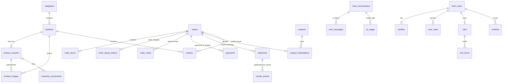

# Database

PostgreSQL on Supabase. All migrations live in `supabase/migrations/` and are applied in filename order.

| Migration | Contents |
|---|---|
| `…0100_schema.sql` | Enums, tables, constraints, indexes, generated search columns |
| `…0200_functions.sql` | Checkout (`place_order`), cart quote, order state machine, admin operations, dashboard metrics, rate limiting |
| `…0300_security.sql` | Grants, Row Level Security policies, storage buckets, default settings |
| `…0400_reviews.sql` | Verified-buyer review submission |

`supabase/dev/00_supabase_shim.sql` recreates the few Supabase platform objects (roles, `auth.users`, `auth.uid()`, `storage.buckets`) so the same migrations can be tested on plain Postgres. **Never run it on a Supabase project.**

## Entity diagram

`site_settings` (key → JSON), `audit_logs`, `rate_limits` and `support_faqs` stand alone.

## Key design decisions

- **Every product has at least one variant.** Stock lives on variants. A variant's `price`/`sale_price` override the product's; the rule is implemented once in SQL (`variant_unit_price`) and mirrored in `src/lib/pricing.ts` for display.
- **Orders are snapshots.** `order_items` store product name, variant name, SKU, image and unit price at the time of purchase, so editing or deleting a product never changes past orders.
- **Checkout is one transaction** (`place_order`): it validates input, locks the variant rows in a stable order (`SELECT … FOR UPDATE`), re-checks stock, prices every line from the database, evaluates the coupon under a row lock, computes delivery from settings, inserts the order/items/payment/status history, and decrements stock with an atomic `stock >= qty` guard. A `check (stock >= 0)` constraint is the last line of defence.
- **Duplicate submissions** are absorbed by a unique `idempotency_key` generated in the browser per checkout; a retry returns the original order.
- **Order privacy.** Each order stores only the SHA-256 hash of a random secret held by the customer. `get_order_public(number, hash)` returns a masked, customer-safe view, and returns the same `null` for "unknown order" and "wrong secret".
- **State machine.** `order_transition_allowed` defines legal moves (pending → confirmed → packed → shipped → delivered; cancel before shipping; return after shipping). Cancelling or returning restocks automatically and releases the coupon use. Every change is written to `order_status_history` with who made it.
- **Money movements** (`payments`) include verified bKash/Nagad transfers, COD collections and refunds (negative amounts). A transaction ID can be claimed only once (`payments_txid_unique`). Refunds cannot exceed what was collected.
- **Courier bookings**: one active shipment per order (partial unique index), `courier_events.dedupe_key` makes webhooks idempotent, and stale events can't move a shipment backwards.

## Security model

| Who | How they reach data |
|---|---|
| Visitors (`anon`) | `SELECT` on published catalogue, public settings, active FAQs, approved reviews. `EXECUTE` on `quote_cart`, `place_order`, `get_order_public`, `submit_payment_proof`, `submit_review` — each validates its own input. |
| Signed-in non-admins (`authenticated`) | The same, plus their own profile/cart/wishlist/orders. Cannot write the catalogue or grant themselves roles. |
| Admins | `authenticated` with a row in `user_roles` (`is_admin()`), enforced by RLS on every table and by `require_admin()` inside privileged functions. |
| Trusted server code | The connection's own role (Supabase `postgres`) for webhooks, chat bookkeeping and rate limits. Functions such as `system_transition_order` and `rate_limit_hit` are not executable by API roles. |

Server code switches to the `anon` or `authenticated` role inside each transaction (`set local role …` plus `request.jwt.claims`), so RLS applies to app queries exactly as it does through the Supabase REST API. This is covered by `tests/integration/database.test.ts`.

## Indexes worth knowing

- `products_search_idx` (GIN on a weighted `tsvector` of names, Bangla name, tags, SKU, descriptions) and `products_name_trgm_idx` for search.
- `orders_status_idx`, `orders_created_idx`, `orders_phone_idx`, `orders_name_trgm_idx` for the admin order list.
- `shipments_one_active_idx` (unique, partial) prevents double booking.

## Ads tracking

- `orders.attribution` (jsonb): UTM tags, click IDs (`fbclid`, `ttclid`, `gclid`), landing page, referrer and a derived `channel`, written once by trusted server code when the order is placed. It also briefly holds the IP, user agent and `_fbp`/`_fbc`/`_ttp` cookies needed to match the server-side Purchase; IP and user agent are removed as soon as Purchase is sent, and all matching fields are purged after 8 days by `/api/cron/cleanup`. Indexed on `(attribution->>'channel', created_at)` for the analytics breakdown.
- `orders.purchase_tracked_at`: set atomically (`update … where purchase_tracked_at is null returning …`) so each order's Purchase reaches Meta/TikTok at most once, whether it is triggered on placement or on confirmation.
- `tracking_events`: one row per server-side event per platform (sent / failed / skipped, HTTP status, short response detail, test mode). Admin-read only via RLS; kept 90 days.
- Settings: `tracking` (public — pixel IDs, Purchase trigger, TikTok purchase event name, server-events switch) and `tracking_secrets` (private — access tokens and test event codes; never sent to the browser or the audit log).
- `quote_cart` and `get_order_public` return item SKUs so browser events use the same content IDs as the server and the catalogue feed.

## Customer accounts

- `customer_accounts`: one row per phone number (`01XXXXXXXXX`), created when the phone first orders (`created_via = 'order'`, backfilled from existing orders) or first logs in. `verified_at` is set the first time the owner logs in with an SMS code. Orders are linked by phone, so all past orders appear after login.
- `customer_otps`: login codes as keyed SHA-256 hashes with expiry (5 min), attempt counter (max 5) and single-use `consumed_at`.
- `customer_sessions`: hashed session tokens (60 days) for the `sn_session` httpOnly cookie.
- `sms_log`: masked number, gateway and response for every SMS; `dev_sms_outbox`: development/test-only stand-in for a real gateway.
- All five tables have RLS on with no anon access; server code reaches them as the trusted role, and admins can read accounts and the SMS log. Cleanup cron removes old codes, expired sessions and old log rows.

## Admin speed and customer risk (migrations 20261029001000 and 20261029001100)

**For whoever runs the database:** migrations `20261029001000_admin_speed_and_risk.sql` and `20261029001100_rls_initplan.sql` must be applied (`supabase db push` or `npm run db:migrate`) before deploying this version. The admin orders, customers and analytics pages read the objects below and fail without them. They are additive and safe to run on a live database.

- `20261029001000_admin_speed_and_risk.sql`: `customer_stats` (one row per phone, kept current by a trigger on `orders` and backfilled from existing orders; admin read-only via RLS), trigram indexes on `orders.order_number` and `orders.phone`, an index on `shipments.order_id`, and `customer_risk(phone)` (admin only), which returns the phone's order outcomes and per-courier parcel results.
- `20261029001100_rls_initplan.sql`: rewrites every `public` RLS policy that calls `is_admin()` or `auth.uid()` to `(select ...)` so Postgres evaluates it once per query instead of once per row. Same rules and results; at 60,000 orders it turns a 1 s `count(*)` into ~25 ms for admins.
- Settings: product pages show an "Order on WhatsApp" button only when Admin > Settings > WhatsApp holds a valid Bangladeshi number.

## Homepage promotions (migration 20261102000200)

Apply `20261102000200_promo_content.sql` before deploying a version that includes homepage promotions. The storefront reads `hero_banners` and `ticker_items` while `next build` prerenders the homepage; if this migration is missing from the target database, the Vercel build fails with a missing-relation error.
